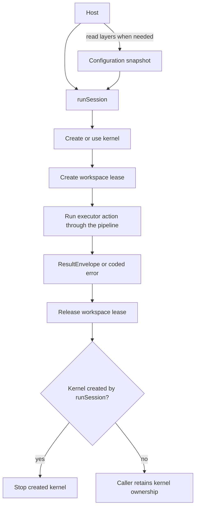

import Diagram from '@site/src/components/Diagram'
import LayeredArchitecture from '@site/src/components/diagrams/LayeredArchitecture'
import ProjectionLedger from '@site/src/components/diagrams/ProjectionLedger'

# Architecture and topology

brambo is an SDK-first microkernel. A zero-dependency kernel and a contracts package of ports sit at the bottom; every implementation, world and binding sits above them and depends only downward. The CLI is the topmost, thinnest layer, not the center of the design.

## The downward graph

<Diagram><LayeredArchitecture /></Diagram>

Every package has a numbered tier, and a package may import only packages in a strictly lower tier. A sibling import at the same tier is a violation. This is not a diagram convention: `packages/contracts/test/topology.test.ts` reads every import specifier under each package's `src/` and fails the build on an upward or sideways edge, on a package missing from the tier map, and on a tier entry for a package that no longer exists.

| Tier | Packages | Role |
|---|---|---|
| 0 | `kernel`, `contracts` | Plugin kernel; ports, validators, error codes, contract suites |
| 1 | `lock`, `delegation`, `provenance`, `sandbox`, `sandbox-local`, `sandbox-remote` | Primitives and sandbox providers |
| 2 | `adapter-cli`, `adapter-acp`, `workspace-local`, `workspace-git-worktree`, `memory-filesystem`, `memory-sqlite`, `registry`, `projection`, `workflow-store-sqlite`, `workflow-remote`, `workspace-artifacts-local`, `runtime-local` | Port implementations |
| 3 | `environment`, `orchestration` | Environment and durable composition |
| 4 | `session` | Session composition |
| 5 | `adapter-api` | API executor registry, retry and tool-loop primitives |
| 6 | `adapter-openai`, `adapter-anthropic` | API providers |
| 7 | `workflow-coordinator` | HTTP control plane and worker |
| 8 | `cli` | `brambo` argv, JSON and exit codes |

Two further guards back the table:

- `eslint.config.js` bans relative imports that climb out of a package (`../..`), forbids the kernel from importing `@brambodev/contracts`, and forbids the CLI from importing `node:fs` or any composition name (`createKernel`, `createSessionKernel`, `createExecutorAdapter`, `selectExecutor` and others). The CLI therefore cannot own composition, even through a re-export.
- `packages/kernel/test/guard.test.ts` pins the kernel to zero runtime dependencies and one entry point.

## Runtime composition

A host normally enters through `@brambodev/session`:

1. `readExecutorConfigLayers` reads brambo's configuration documents (optional; `runSession` never reads files itself).
2. `createSessionKernel` (or `runSession` internally) mounts the executor and workspace plugins on a kernel and seeds its layered configuration.
3. `runSession` creates a workspace, then registers the executor run as an action on the kernel's pipeline, so budgets and records apply to it.
4. The adapter returns a `ResultEnvelope`; the session releases the workspace lease, disposes what it created, and stops a kernel it built.

A kernel you pass in stays yours: `runSession` never stops it, so several sessions can share one kernel and one budget.

## Registry ingestion and projection

<Diagram><ProjectionLedger /></Diagram>

The environment world is separate from sessions. Ingestion validates an entry and stores it in a scoped registry; projection is a separate, explicit operation that writes each executor's native configuration and records what it wrote in an ownership ledger (`~/.brambo/projection-ledger.json`). The native file is written before the ledger records it, so a crash under-claims rather than over-claims.

## Stable boundaries

| Boundary | Owns | Does not own |
|---|---|---|
| Kernel | Plugin validation, service graph, ordered start/stop/swap, events, layered config, action budgets, records | Executors, registries, transports, storage |
| Contracts | Port types, validators, coded errors, contract suites | Any implementation |
| Session | One executor turn: composition, workspace lease, cleanup order | Signals, deadlines, transcripts |
| Orchestration | Durable task graph over a `RunStore` and `ArtifactProvider` | Storage engine, process isolation, authentication |
| Projection | Native vendor files plus the ownership ledger | Vendor files brambo did not write |

Read [Kernel](./kernel) for the plugin model, [Design principles](./principles) for the rules every package follows.
