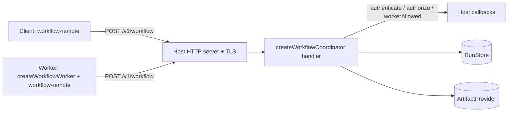

# Coordinator, worker and remote client

The tutorial ran everything in one process. To run tasks on other machines, put the `RunStore` and `ArtifactProvider` behind a coordinator and give workers a remote client. brambo supplies the request handler, the worker loop and the client; you supply the HTTP server, TLS, identity, deployment and supervision. [Deploy a host-owned coordinator](./remote-orchestration) has the deployment recipe; this page explains the moving parts.



## The workflow protocol

Every operation is one JSON envelope sent to one route, `POST /v1/workflow`:

- Request: `{ version: 1, operation, payload }`.
- Response: `{ version: 1, status: 'ok' | 'denied' | 'invalid' | 'unavailable', payload?, code? }`.
- Operations mirror the ports: `create`, `admit`, `get`, `receipt`, `pending`, `commit`, `events`, `claim`, `renew`, `release`, `valid`, `artifact.manifest`, `artifact.read`, `artifact.stage`, `artifact.publish`.

## What the coordinator checks

`createWorkflowCoordinator({ store, artifacts, authenticate, authorize, workerAllowed, maxBodyBytes? })` returns `{ handler, close }`. The handler is a Node.js `RequestListener`; it does not listen on a port. All three callbacks are required; a missing one throws at construction.

Each request goes through, in order:

| Step | Failure |
|---|---|
| Method and path are `POST /v1/workflow` | 404 `invalid` |
| `content-type` is JSON | 415 |
| Body within `maxBodyBytes` (default and maximum 1 MiB) | 413, connection closed |
| Valid JSON and envelope | 400 `invalid` |
| `authenticate(request)` returns a `Principal` | 404 `denied`; a throw is 503 `unavailable` |
| Request scope: namespace equals the principal's namespace; lease operations require `lease.ownerId === principal.subject` | 404 `denied` |
| `authorize(principal, operation, resource)` | 404 `denied` |
| Worker operations (`commit`, `claim`, `renew`, `release`, `valid`, `artifact.publish`) also need `workerAllowed(principal)` | 404 `denied` |
| Execute against the store or artifacts | 200 with the result, or 503 |

`authorize` receives a validated, credential-free resource description, never raw payloads or lease tokens. A `claim` always uses the authenticated principal as the owner; the client cannot choose it. Responses carry `cache-control: no-store`. Every denial, including a missing run, answers 404.

## The worker

`createWorkflowWorker(options)` returns `{ runOnce(signal), stop() }`. It has no scheduler: call `runOnce` from your own loop.

Each `runOnce`:

1. Lists pending receipts (cancels first) and skips unfinished imports.
2. Claims the run's lease resources; a contended run is skipped.
3. Commits `worker.receipt.running`, then runs the injected `execute` (normally `runDurableWorkflow`) with each task in a fresh `task-<uuid>` workspace.
4. Renews the parent lease on a timer (`renewalMs`, default a third of `leaseTtlMs`, which defaults to 30 s) and aborts the run if renewal fails or a cancel arrives.
5. Settles the related receipts as `completed` or `blocked`, releases the lease, and returns `true` if it ran a run.

A concurrent `runOnce` on the same worker rejects with `Workflow worker already running`.

Every tool call a worker dispatches is journaled as `non-idempotent`:

- A completed effect is replayed only if your `authorizeReplay` returns `true`.
- A new effect is dispatched through your `dispatchTool`; an unknown rejection becomes `UncertainToolEffectError`.
- An uncertain effect throws `UncertainToolEffectError`; nothing is re-sent.

Workers require context reconstruction: the driver and the runtime must both advertise `context-reconstruction`, and your `authorizeReconstruction` must approve. Secrets come only from your `resolveSecret`, called with the receipt's original actor.

## The remote client

`@brambodev/workflow-remote` gives clients and workers the same ports over the protocol:

```ts
import { createRemoteArtifactProvider, createRemoteRunStore, replayRun } from '@brambodev/workflow-remote'

const options = {
  endpoint: 'https://workflows.example.internal/v1/workflow',
  fetch,
  authorizeRequest: async () => ({ authorization: `Bearer ${await currentToken()}` }),
}
const store = createRemoteRunStore(options)
const artifacts = createRemoteArtifactProvider(options)
const page = await replayRun(store, { namespace: 'acme', runId: 'run-1' }, 0, 100)
```

| Behavior | Detail |
|---|---|
| Endpoint | `http` or `https`; no user info, query or fragment |
| Requests | `POST`, `redirect: 'error'`, `credentials: 'omit'`, body at most 1 MiB, fresh headers from `authorizeRequest` per request |
| Responses | At most `maxResponseBytes` (default 1 MiB, up to 64 MiB); shapes and scope are validated |
| `denied` | `get` and `receipt` return `undefined`, `pending` returns `[]`; other operations throw |
| Paging | Limits above 256 are rejected |
| Staging | Local directory walk up to depth 128, 10,000 entries and 768 KiB of content; symlinks rejected |
| Failures | Plain `Error`: `Remote workflow unavailable`, `Invalid remote workflow response`, `Remote workflow aborted`, `Remote workflow client closed` |

The client never falls back to a local writer. Reconnecting reads snapshots and event pages; replay does not execute tools.

## What you still own

TLS, the HTTP server, authentication, authorization policy, worker supervision and restarts, deadlines, backups and retention. The coordinator's `close()` does not close your store or server.

## Next step

Follow [Deploy a host-owned coordinator](./remote-orchestration) for the deployment fragments and checklist.
