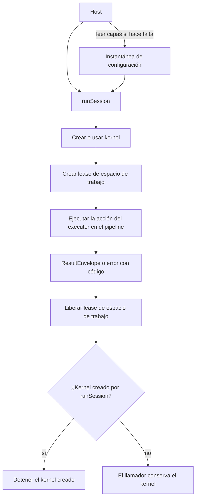

import Diagram from '@site/src/components/Diagram'
import LayeredArchitecture from '@site/src/components/diagrams/LayeredArchitecture'
import ProjectionLedger from '@site/src/components/diagrams/ProjectionLedger'

# Arquitectura y topología

brambo es un microkernel orientado al SDK. En la base hay un kernel sin dependencias y un paquete de contratos con los puertos; cada implementación, mundo y binding se sitúa por encima y solo depende hacia abajo. La CLI es la capa superior y más delgada, no el centro del diseño.

## El grafo descendente

<Diagram><LayeredArchitecture /></Diagram>

Cada paquete tiene un nivel numerado, y un paquete solo puede importar paquetes de un nivel estrictamente inferior. Importar un paquete del mismo nivel es una infracción. No es una convención del diagrama: `packages/contracts/test/topology.test.ts` lee cada especificador de importación en el `src/` de cada paquete y hace fallar la compilación ante una arista ascendente o lateral, ante un paquete que falte en el mapa de niveles y ante una entrada de nivel para un paquete que ya no existe.

| Nivel | Paquetes | Función |
|---|---|---|
| 0 | `kernel`, `contracts` | Kernel de plugins; puertos, validadores, códigos de error, suites de contrato |
| 1 | `lock`, `delegation`, `provenance`, `sandbox`, `sandbox-local`, `sandbox-remote` | Primitivas y proveedores de sandbox |
| 2 | `adapter-cli`, `adapter-acp`, `workspace-local`, `workspace-git-worktree`, `memory-filesystem`, `memory-sqlite`, `registry`, `projection`, `workflow-store-sqlite`, `workflow-remote`, `workspace-artifacts-local`, `runtime-local` | Implementaciones de puertos |
| 3 | `environment`, `orchestration` | Composición del entorno y del mundo durable |
| 4 | `session` | Composición de sesiones |
| 5 | `adapter-api` | Registro de executors de API, reintentos y bucle de herramientas |
| 6 | `adapter-openai`, `adapter-anthropic` | Proveedores de API |
| 7 | `workflow-coordinator` | Plano de control HTTP y worker |
| 8 | `cli` | Argumentos, JSON y códigos de salida de `brambo` |

Dos protecciones adicionales respaldan la tabla:

- `eslint.config.js` prohíbe las importaciones relativas que salen de un paquete (`../..`), impide que el kernel importe `@brambodev/contracts` e impide que la CLI importe `node:fs` o cualquier nombre de composición (`createKernel`, `createSessionKernel`, `createExecutorAdapter`, `selectExecutor` y otros). Por tanto, la CLI no puede ser dueña de la composición, ni siquiera mediante una reexportación.
- `packages/kernel/test/guard.test.ts` fija el kernel en cero dependencias de ejecución y un único punto de entrada.

## Composición en tiempo de ejecución

Un host normalmente entra por `@brambodev/session`:

1. `readExecutorConfigLayers` lee los documentos de configuración de brambo (opcional; `runSession` nunca lee archivos por sí mismo).
2. `createSessionKernel` (o `runSession` internamente) monta los plugins de executor y de espacio de trabajo en un kernel y siembra su configuración por capas.
3. `runSession` crea un espacio de trabajo y registra la ejecución del executor como una acción en el pipeline del kernel, de modo que se le aplican presupuestos y registros.
4. El adaptador devuelve un `ResultEnvelope`; la sesión libera el lease del espacio de trabajo, desecha lo que creó y detiene el kernel que construyó.

Un kernel suministrado sigue siendo del llamador: `runSession` nunca lo detiene, de modo que varias sesiones pueden compartir un kernel y un presupuesto.

## Ingesta y proyección del registro

<Diagram><ProjectionLedger /></Diagram>

El mundo de entorno está separado de las sesiones. La ingesta valida una entrada y la guarda en un registro con ámbito; la proyección es una operación separada y explícita que escribe la configuración nativa de cada executor y registra lo que escribió en un registro de propiedad (`~/.brambo/projection-ledger.json`). El archivo nativo se escribe antes de que el registro lo anote, de modo que una caída reclama de menos y nunca de más.

```mermaid
flowchart LR
  accTitle: Ingesta y proyección del registro
  accDescr: Un origen del registro aporta una entrada clonada y validada al almacenamiento con ámbito. Una operación de proyección separada lee esa entrada y el registro de propiedad, escribe un destino nativo y anota el resultado propio en el registro.
  Origin[Origen del registro] --> Validate[Clonar y validar entrada]
  Validate --> Scope[Almacenamiento con ámbito]
  Scope -. operación separada .-> Project[runProjection]
  Ledger[Leer registro de propiedad] --> Project
  Project --> Target[Escribir destino nativo en secuencia]
  Target --> Update[Anotar la salida propia]
  Update --> Ledger
```

## Fronteras estables

| Frontera | Es dueña de | No es dueña de |
|---|---|---|
| Kernel | Validación de plugins, grafo de servicios, arranque, parada y sustitución ordenados, eventos, configuración por capas, presupuestos de acciones, registros | Executors, registros de entradas, transportes, almacenamiento |
| Contracts | Tipos de puertos, validadores, errores con código, suites de contrato | Cualquier implementación |
| Session | Un turno de executor: composición, lease del espacio de trabajo, orden de limpieza | Señales, plazos, transcripciones |
| Orchestration | Grafo de tareas durable sobre un `RunStore` y un `ArtifactProvider` | Motor de almacenamiento, aislamiento de procesos, autenticación |
| Projection | Archivos nativos de los proveedores y el registro de propiedad | Archivos de proveedores que brambo no escribió |

Consulte [El kernel](./kernel) para el modelo de plugins y [Principios de diseño](./principles) para las reglas que sigue cada paquete.
