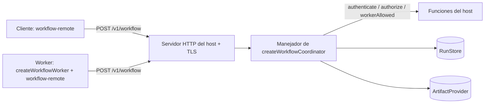

# Coordinador, worker y cliente remoto

El tutorial ejecutó todo en un proceso. Para ejecutar tareas en otras máquinas, coloque el `RunStore` y el `ArtifactProvider` detrás de un coordinador y dé a los workers un cliente remoto. brambo suministra el manejador de solicitudes, el bucle del worker y el cliente; usted suministra el servidor HTTP, TLS, la identidad, el despliegue y la supervisión. [Desplegar un coordinador propiedad del host](./remote-orchestration) contiene la receta de despliegue; esta página explica las piezas.



## El protocolo de flujos

Cada operación es un sobre JSON enviado a una única ruta, `POST /v1/workflow`:

- Solicitud: `{ version: 1, operation, payload }`.
- Respuesta: `{ version: 1, status: 'ok' | 'denied' | 'invalid' | 'unavailable', payload?, code? }`.
- Las operaciones reflejan los puertos: `create`, `admit`, `get`, `receipt`, `pending`, `commit`, `events`, `claim`, `renew`, `release`, `valid`, `artifact.manifest`, `artifact.read`, `artifact.stage`, `artifact.publish`.

## Qué comprueba el coordinador

`createWorkflowCoordinator({ store, artifacts, authenticate, authorize, workerAllowed, maxBodyBytes? })` devuelve `{ handler, close }`. El manejador es un `RequestListener` de Node.js; no escucha en ningún puerto. Las tres funciones son obligatorias; si falta una, la construcción lanza un error.

Cada solicitud pasa, en orden, por:

| Paso | Fallo |
|---|---|
| Método y ruta son `POST /v1/workflow` | 404 `invalid` |
| `content-type` es JSON | 415 |
| Cuerpo dentro de `maxBodyBytes` (1 MiB por defecto y como máximo) | 413, conexión cerrada |
| JSON y sobre válidos | 400 `invalid` |
| `authenticate(request)` devuelve un `Principal` | 404 `denied`; una excepción es 503 `unavailable` |
| Ámbito de la solicitud: el namespace coincide con el del principal; las operaciones con lease exigen `lease.ownerId === principal.subject` | 404 `denied` |
| `authorize(principal, operation, resource)` | 404 `denied` |
| Las operaciones de worker (`commit`, `claim`, `renew`, `release`, `valid`, `artifact.publish`) también necesitan `workerAllowed(principal)` | 404 `denied` |
| Ejecución contra el almacén o los artefactos | 200 con el resultado, o 503 |

`authorize` recibe una descripción del recurso validada y sin credenciales, nunca cargas en bruto ni tokens de lease. Un `claim` siempre usa el principal autenticado como dueño; el cliente no puede elegirlo. Las respuestas llevan `cache-control: no-store`. Toda denegación, incluida la de una ejecución inexistente, responde 404.

## El worker

`createWorkflowWorker(options)` devuelve `{ runOnce(signal), stop() }`. No tiene planificador: llame a `runOnce` desde su propio bucle.

Cada `runOnce`:

1. Enumera los recibos pendientes (primero las cancelaciones) y omite las importaciones sin terminar.
2. Reclama los recursos de lease de la ejecución; una ejecución en contención se omite.
3. Confirma `worker.receipt.running` y ejecuta el `execute` inyectado (normalmente `runDurableWorkflow`) con cada tarea en un espacio de trabajo nuevo `task-<uuid>`.
4. Renueva el lease padre con un temporizador (`renewalMs`, por defecto un tercio de `leaseTtlMs`, que por defecto es 30 s) y aborta la ejecución si falla la renovación o llega una cancelación.
5. Liquida los recibos relacionados como `completed` o `blocked`, libera el lease y devuelve `true` si ejecutó alguna ejecución.

Un `runOnce` concurrente en el mismo worker se rechaza con `Workflow worker already running`.

Cada llamada a herramienta que despacha un worker se anota como `non-idempotent`:

- Un efecto completado solo se reproduce si su `authorizeReplay` devuelve `true`.
- Un efecto nuevo se despacha mediante su `dispatchTool`; un rechazo desconocido se convierte en `UncertainToolEffectError`.
- Un efecto incierto lanza `UncertainToolEffectError`; no se reenvía nada.

Los workers requieren reconstrucción de contexto: el driver y el runtime deben anunciar `context-reconstruction`, y su `authorizeReconstruction` debe aprobarla. Los secretos solo provienen de su `resolveSecret`, llamado con el actor original del recibo.

## El cliente remoto

`@brambodev/workflow-remote` da a clientes y workers los mismos puertos sobre el protocolo:

```ts
import { createRemoteArtifactProvider, createRemoteRunStore, replayRun } from '@brambodev/workflow-remote'

const options = {
  endpoint: 'https://workflows.example.internal/v1/workflow',
  fetch,
  authorizeRequest: async () => ({ authorization: `Bearer ${await currentToken()}` }),
}
const store = createRemoteRunStore(options)
const artifacts = createRemoteArtifactProvider(options)
const page = await replayRun(store, { namespace: 'acme', runId: 'run-1' }, 0, 100)
```

| Comportamiento | Detalle |
|---|---|
| Endpoint | `http` o `https`; sin información de usuario, consulta ni fragmento |
| Solicitudes | `POST`, `redirect: 'error'`, `credentials: 'omit'`, cuerpo de 1 MiB como máximo, cabeceras nuevas de `authorizeRequest` en cada solicitud |
| Respuestas | Como máximo `maxResponseBytes` (1 MiB por defecto, hasta 64 MiB); se validan la forma y el ámbito |
| `denied` | `get` y `receipt` devuelven `undefined`, `pending` devuelve `[]`; las demás operaciones lanzan un error |
| Paginación | Se rechazan límites superiores a 256 |
| Preparación | Recorrido local del directorio hasta profundidad 128, 10.000 entradas y 768 KiB de contenido; se rechazan los enlaces simbólicos |
| Fallos | `Error` simple: `Remote workflow unavailable`, `Invalid remote workflow response`, `Remote workflow aborted`, `Remote workflow client closed` |

El cliente nunca recurre a un escritor local. Al reconectar lee instantáneas y páginas de eventos; la reproducción no ejecuta herramientas.

## Lo que sigue siendo suyo

TLS, el servidor HTTP, la autenticación, la política de autorización, la supervisión y el reinicio de workers, los plazos, las copias de seguridad y la retención. El `close()` del coordinador no cierra su almacén ni su servidor.

## Próximo paso

Siga [Desplegar un coordinador propiedad del host](./remote-orchestration) para los fragmentos de despliegue y la lista de comprobación.
